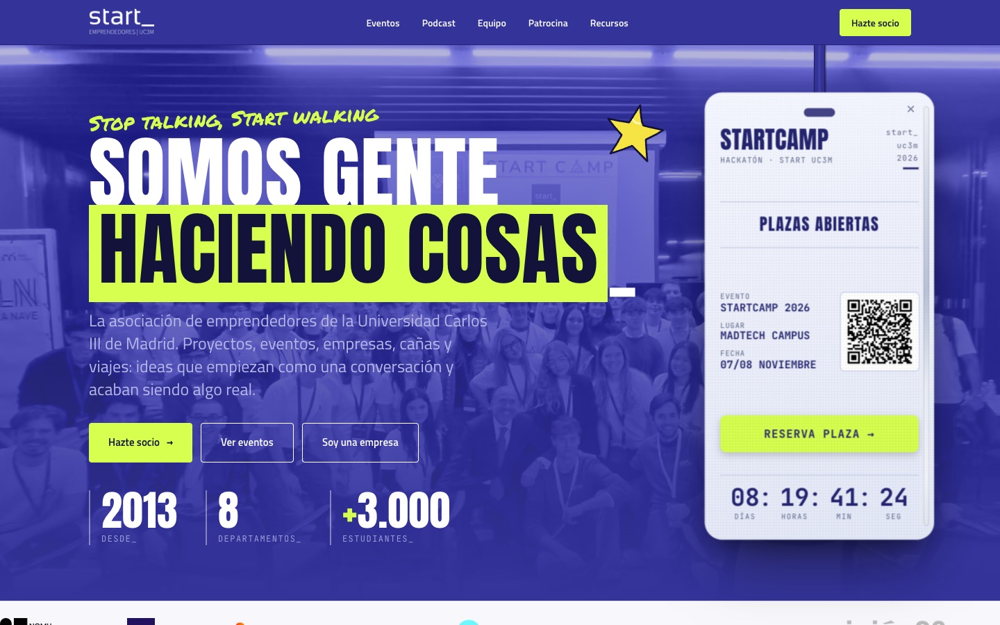
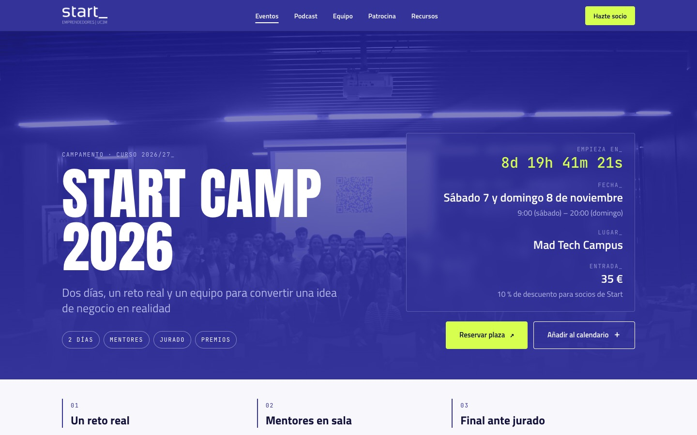
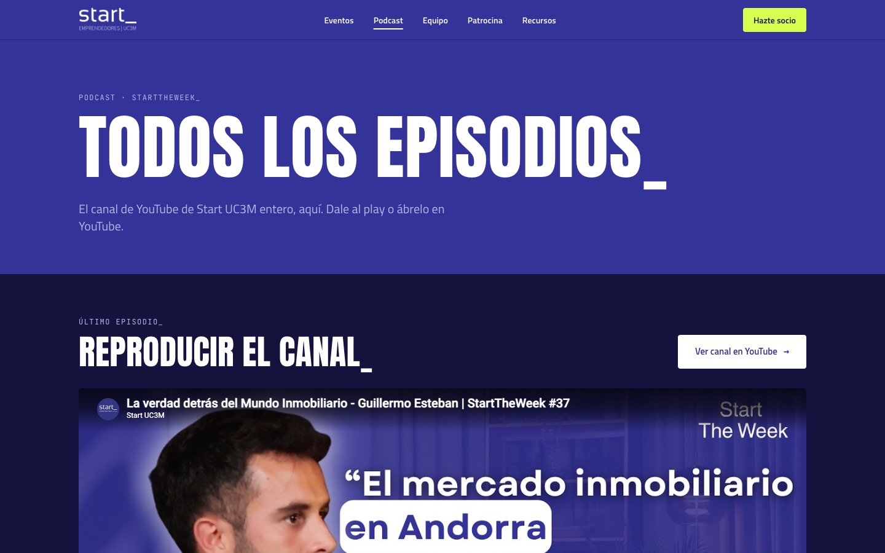
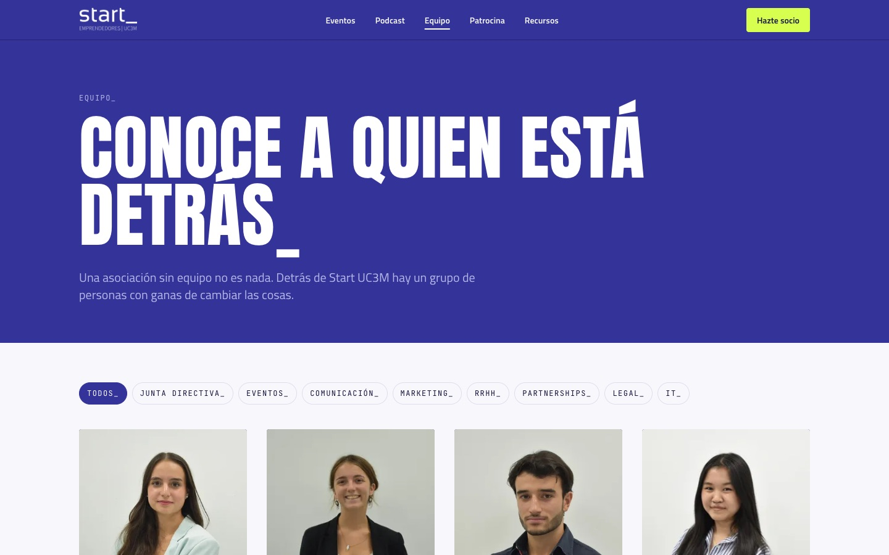
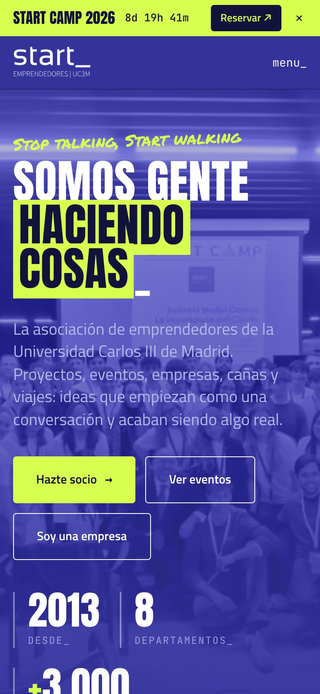
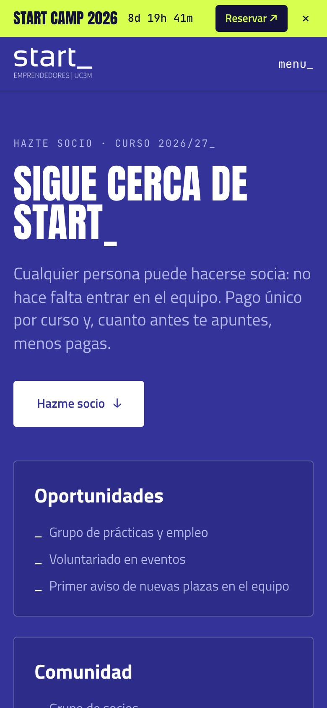
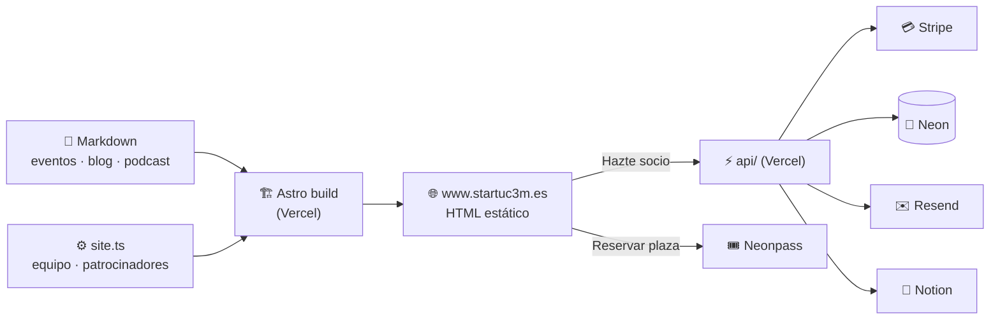

<div align="center">

<a href="https://www.startuc3m.es">
  <picture>
    <source media="(prefers-color-scheme: dark)" srcset="public/brand/logo-full-white.png">
    
  </picture>
</a>

### La web de la asociación de emprendedores de la Universidad Carlos III de Madrid

**[startuc3m.es](https://www.startuc3m.es)** · [Documentación](docs/README.md) · [Issues](https://github.com/startuc3m/start-uc3m/issues) · [Instagram](https://www.instagram.com/startuc3m/)

<br>


</div>

<br>



<table>
  <tr>
    <td width="33%"></td>
    <td width="33%"></td>
    <td width="33%"></td>
  </tr>
  <tr>
    <td align="center"><sub><b>Fichas de evento</b> · premios, mentores, info práctica</sub></td>
    <td align="center"><sub><b>Podcast</b> · los episodios de StartTheWeek</sub></td>
    <td align="center"><sub><b>Equipo</b> · filtro por departamento</sub></td>
  </tr>
</table>

<table>
  <tr>
    <td width="50%" valign="top">

### Qué es

La web pública de **Start UC3M**: eventos (Buildathon, StartXperience, Start Camp…), el podcast **StartTheWeek**, el equipo, el media kit para empresas y el **alta y pago de socios**.

Es **100 % estática**: cada página se genera en el build a partir de markdown. Lo único con servidor son los **socios** (Stripe + Postgres) y el **formulario de contacto**.

</td>
    <td width="25%" align="center"></td>
    <td width="25%" align="center"></td>
  </tr>
</table>

## ⚡ Arrancar en 1 minuto

```bash
git clone https://github.com/startuc3m/start-uc3m.git && cd start-uc3m
npm install
npm run dev          # → http://localhost:4321
```

No hace falta ninguna variable de entorno para la parte pública. Para socios y formularios, mira [01 · Empezar](docs/01-empezar.md).

| Comando | |
|---|---|
| `npm run dev` | Web en local con recarga en caliente |
| `npm run build` | Genera `dist/`. Si falla aquí, fallará en Vercel |
| `npm test` | Tests (Vitest) |
| `npm run dev:api` | Funciones de socios y contacto en el puerto 3001 |

## 🧭 Cómo funciona



**Cada merge a `main` se publica solo.** Cada PR tiene su vista previa en Vercel.

## ✏️ Cambiar contenido

| Quiero… | Edito |
|---|---|
| Crear o cambiar un **evento** | `src/content/eventos/<id>.md` |
| Añadir un **episodio** del podcast | `src/content/podcast/ep-NN.md` |
| Publicar un **post** | `src/content/blog/<id>.md` |
| Cambiar el **equipo**, patrocinadores, enlaces o recursos | `src/lib/site.ts` |
| Cambiar las **fotos** de un evento | `src/lib/fotos.ts` + `src/assets/fotos/` |

Guía completa, campo a campo, en **[04 · Contenido](docs/04-contenido.md)**. Se puede editar hasta desde la web de GitHub, sin instalar nada.

> [!IMPORTANT]
> **No se publica nada que no esté confirmado**: fechas, cifras, premios, ponentes, promesas a empresas. Si algo está a medias, va con `draft: true`.

## 📚 Documentación

<table>
  <tr>
    <td><b><a href="docs/01-empezar.md">01 · Empezar</a></b><br><sub>Instalar, arrancar, accesos y primer PR</sub></td>
    <td><b><a href="docs/02-arquitectura.md">02 · Arquitectura</a></b><br><sub>Cómo encaja todo, rutas y diagramas</sub></td>
    <td><b><a href="docs/03-mapa-del-repo.md">03 · Mapa del repo</a></b><br><sub>Qué hay en cada carpeta y archivo</sub></td>
  </tr>
  <tr>
    <td><b><a href="docs/04-contenido.md">04 · Contenido</a></b><br><sub>Eventos, blog, podcast, equipo y fotos</sub></td>
    <td><b><a href="docs/05-diseno.md">05 · Diseño</a></b><br><sub>Brand kit, componentes, animaciones y accesibilidad</sub></td>
    <td><b><a href="docs/06-start-camp.md">06 · Start Camp</a></b><br><sub>Lanyard, banner, cuenta atrás y qué hacer al acabar</sub></td>
  </tr>
  <tr>
    <td><b><a href="docs/07-formularios.md">07 · Formularios</a></b><br><sub>Contacto y patrocinio con Resend</sub></td>
    <td><b><a href="docs/socios.md">Socios</a></b><br><sub>Stripe, Neon, Resend y Notion</sub></td>
    <td><b><a href="docs/08-despliegue.md">08 · Despliegue</a></b><br><sub>Vercel, variables, dominios, analítica y rollback</sub></td>
  </tr>
  <tr>
    <td><b><a href="docs/09-calidad.md">09 · Calidad</a></b><br><sub>Tests, CI, QA y Lighthouse</sub></td>
    <td><b><a href="docs/10-como-trabajamos.md">10 · Cómo trabajamos</a></b><br><sub>Ramas, commits, PRs y reglas de Start</sub></td>
    <td><b><a href="docs/11-problemas.md">11 · Problemas frecuentes</a></b><br><sub>Errores conocidos y su solución</sub></td>
  </tr>
</table>

Y además: [decisiones técnicas y de producto](docs/decisiones.md), con fecha y su porqué, y el [perfil del Start Camp](docs/startcamp-perfil.md) (React + Supabase).

## 🗂️ El repo de un vistazo

```
api/            Funciones de Vercel: socios (Stripe) y contacto (Resend)
db/             Esquema SQL y scripts de socios
docs/           Documentación
public/         Logos, vídeo y archivos que se sirven tal cual
src/
├─ content/     📝 Eventos, blog y podcast en markdown
├─ lib/         ⚙️ site.ts (equipo, patrocinadores…), fotos, animaciones
├─ pages/       Una página por archivo
├─ components/  Piezas reutilizables y Start Camp
├─ socios/      Alta de socios (React)
├─ startcamp/   Perfil del Start Camp (React + Supabase)
└─ styles/      Brand kit: colores y tipografías
```

## 🤝 Contribuir

1. Elige o crea un **issue**.
2. Rama desde `main`: `feat/<n>-tema` o `fix/<n>-tema`.
3. Antes de subir: `npm run build && npm test`, en móvil y escritorio.
4. **PR** contra `main`, en español y con *conventional commits* (`feat(eventos): …`), enlazando el issue.
5. Lo revisa **Alejandro Ausina** (responsable de IT) y, al mergear, se publica solo.

Todo el detalle está en [10 · Cómo trabajamos](docs/10-como-trabajamos.md).

<br>

<div align="center">
<sub>Hecho por el departamento de IT de <b>Start UC3M</b> · <a href="https://www.startuc3m.es/equipo">conoce al equipo</a><br>
Diseño de partida de <a href="https://github.com/aaangelmartin/WebStartUC3M">Ángel Martín</a>, con el brand kit de Marketing 26/27</sub>
<br><br>
<code>stop talking, start walking_</code>
</div>
