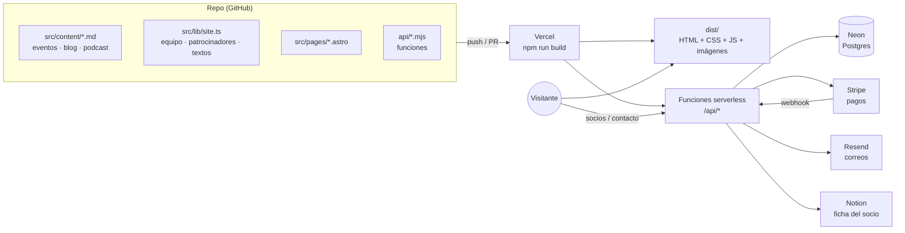
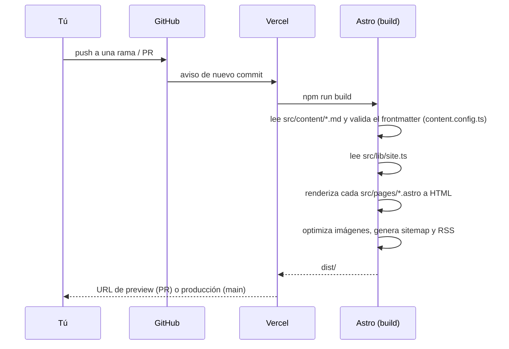

# 02 · Arquitectura

La idea en una frase: **la web es un conjunto de páginas HTML que se generan una vez, en el build, a partir de archivos markdown y de `src/lib/site.ts`**. Solo hay servidor para dos cosas: el alta y pago de socios, y el formulario de contacto.

## Visión general

## Stack

| Pieza | Qué es | Dónde se configura |
|---|---|---|
| [Astro 7](https://astro.build) | Genera las páginas estáticas (`output: 'static'`) | `astro.config.mjs` |
| [Tailwind CSS v4](https://tailwindcss.com) | Estilos con clases; los colores y fuentes de marca son *tokens* | `src/styles/global.css` (bloque `@theme`) |
| Content Collections de Astro | Eventos, blog y podcast como markdown con esquema validado (zod) | `src/content.config.ts` |
| `astro:assets` | Optimiza las fotos (AVIF/WebP al tamaño de cada hueco) en el build | `src/components/Photo.astro`, `src/lib/fotos.ts` |
| [GSAP](https://gsap.com) + ScrollTrigger y [Lenis](https://lenis.darkroom.engineering) | Animaciones de entrada y scroll suave | `src/lib/motion.ts` |
| React 19 | **Solo** como "islas": socios, privacidad y el lanyard de Start Camp | `@astrojs/react` en `astro.config.mjs` |
| Funciones de Vercel (Node) | Socios y contacto, en `api/` | `vercel.json` (máx. 15 s por llamada) |
| Neon (Postgres) | Socios, números de socio y *rate limiting* | `db/schema.sql` |
| Stripe · Resend · Notion | Pagos · correos · ficha del socio en el Notion de Start | Variables de entorno de Vercel |
| Vitest + Testing Library | Tests de la web | `vitest.config.mjs` |
| `@astrojs/sitemap`, `@astrojs/rss` | `sitemap-index.xml` y el RSS del blog | `astro.config.mjs`, `src/pages/blog/rss.xml.ts` |

## Cómo se genera una página

Consecuencias importantes de que sea estática:

- **Cambiar contenido = cambiar un archivo y desplegar.** No hay panel ni base de datos de contenido.
- **El estado de los eventos depende de la fecha del build.** `src/lib/content.ts` marca como `pasado` cualquier evento cuya fecha ya ha pasado, aunque nadie haya cambiado su `status`. Si un evento acaba y nadie despliega, seguirá saliendo como "abierto" hasta el siguiente build.
- **Lo que depende de la hora real se hace en el navegador**: las cuentas atrás de Start Camp y la desaparición del lanyard, el banner y la barra al acabar el evento.
- Si el frontmatter de un `.md` no cumple el esquema, **el build falla**. Es a propósito: es mejor que falle el build a publicar algo roto.

## Las "islas" de React

Casi toda la web es HTML sin JavaScript de framework. React se carga solo donde hace falta:

| Página | Componente | Por qué React |
|---|---|---|
| `/socios` | `src/socios/Socios.jsx` (`client:only`) | Formulario con estado, llama a `/api/membership/*`. Viene de la web anterior tal cual |
| `/socios/telefono` | `SociosTelefono.jsx` (`client:only`) | Lee el token de la URL y llama a la API |
| `/socios/gracias`, `/privacidad` | `SociosGracias.jsx`, `Privacidad.jsx` | Sin `client:`: se renderizan a HTML en el build (no cargan React) |
| `/` (solo ≥ 1024 px) | `src/components/lanyard/startcamp-lanyard.tsx` (`client:only`) | Tarjeta colgante con física. Ver [06 · Start Camp](06-start-camp.md) |

## Rutas

| Ruta | Archivo | Notas |
|---|---|---|
| `/` | `src/pages/index.astro` | Home: hero, patrocinadores, próximo evento, quiénes somos, podcast, momentos, blog (si hay ≥ 3 posts) |
| `/eventos`, `/eventos/<id>` | `src/pages/eventos/index.astro`, `[slug].astro` | Una ficha por cada `.md` publicado de `src/content/eventos` |
| `/podcast` | `src/pages/podcast/index.astro` | Todos los episodios |
| `/blog`, `/blog/<id>`, `/blog/rss.xml` | `src/pages/blog/*` | Oculto del menú con menos de 3 posts publicados |
| `/equipo` | `src/pages/equipo.astro` | Equipo con filtro por departamento (`site.team`) |
| `/socios`, `/socios/gracias`, `/socios/telefono` | `src/pages/socios/*` | Alta de socios. Ver [socios.md](socios.md) |
| `/patrocina`, `/patrocinadores` | `src/pages/patrocina.astro`, `patrocinadores.astro` | Media kit y empresas que nos apoyan |
| `/recursos`, `/unete`, `/contacto`, `/links`, `/privacidad`, `/404` | `src/pages/*.astro` | `/links` es la página para la bio de Instagram |
| `/api/contacto` | `api/contacto.mjs` | Formulario de contacto y patrocinio |
| `/api/membership/*`, `/api/stripe/webhook` | `api/membership/*.mjs`, `api/stripe/webhook.mjs` | Socios |

> **Ojo**: los endpoints van en `api/`, **nunca** en `src/pages/api/`. Con los dos a la vez Vercel no sabe cuál servir (está comentado en `astro.config.mjs`).

## Dominio

El dominio canónico es **`www.startuc3m.es`**. `startuc3m.es` redirige a `www` con un **308**, y esa redirección la hace Vercel antes de llegar a la web. Afecta a cualquier servicio externo que llame a la web: por ejemplo, el webhook de Stripe tiene que apuntar a `https://www.startuc3m.es/api/stripe/webhook`, porque Stripe no sigue redirecciones.

## Siguiente

- Dónde está cada archivo: [03 · Mapa del repo](03-mapa-del-repo.md)
- Cómo se despliega: [08 · Despliegue](08-despliegue.md)
