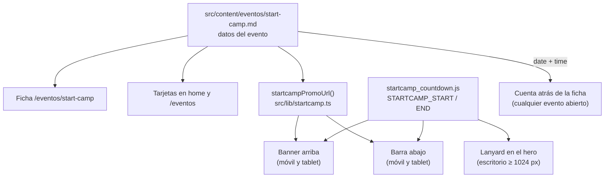

# 06 · Start Camp 2026

Start Camp (del 6 al 8 de noviembre de 2026, Mad Tech Campus) es el evento más importante del curso, y la web lo promociona en todas partes. Este documento explica cada pieza y **qué hacer cuando acabe**.

## Las piezas

| Pieza | Archivo | Dónde sale | Qué hace |
|---|---|---|---|
| **Datos** | `src/content/eventos/start-camp.md` | — | Fechas, lugar, precio, enlace de Neonpass, agenda por días, premios, mentores, jurado e info práctica |
| **Ficha** | `src/pages/eventos/[slug].astro` | `/eventos/start-camp` | Cabecera con cuenta atrás (calculada con `date` y `time` del `.md`; la tiene cualquier evento abierto), horario por días, premios, info práctica, mentores y jurado, galería y botón de compra |
| **Tarjetas** | `src/pages/index.astro`, `src/pages/eventos/index.astro` | Home y `/eventos` | "Reservar plaza" va a Neonpass y "Ver evento", a la ficha |
| **Lanyard** | `src/components/lanyard/startcamp-lanyard.tsx` (+ `lanyard_motion.js`) | Hero de la home, solo ≥ 1024 px | Acreditación colgante que se puede arrastrar, con QR de Neonpass y cuenta atrás. Se puede cerrar (durante la sesión) |
| **Banner** | `src/components/StartcampBanner.astro` | Arriba del menú, en todas las páginas, < 1024 px | Cuenta atrás y "Reservar". Se puede cerrar |
| **Barra** | `src/components/StartcampBar.astro` | Abajo y fija, < 1024 px, al bajar 500 px | Cuenta atrás y "Reservar". No sale en `/socios` (taparía el pago) |
| **Reloj** | `src/components/lanyard/startcamp_countdown.js` | — | `STARTCAMP_START` y `STARTCAMP_END`: la hora del evento para el lanyard, el banner y la barra |
| **Dónde salen los avisos** | `src/lib/startcamp.ts` | — | Ni en la propia ficha ni en las páginas que se le pasen en `exclude` |

## Cambiar datos

- **Premios, mentores, jurado, info práctica, precio:** en `start-camp.md`. Los campos están explicados en [04 · Contenido](04-contenido.md#todos-los-campos). La fuente es la página del proyecto **StartCamp** en el Notion de Start, sección *Confirmado hasta la fecha*. También se aceptan publicaciones oficiales de Start facilitadas como fuente; los premios se contrastaron con Instagram el 2 de noviembre.
- **Enlace de compra:** campo `external` de `start-camp.md`. El lanyard tiene su propio `EVENT_URL` y su QR (`src/assets/component_assets/startcamp-neonpass-qr.svg`): si cambia el enlace, hay que cambiar los tres.
- **Hora de inicio o fin:** en `startcamp_countdown.js` **y** en `date`, `time` y `endTime` de `start-camp.md`. Las dos tienen que coincidir.

## Revisión de confirmados · 2 de noviembre de 2026

Notion se ha consultado solo en lectura. Fuentes contrastadas:

- [Proyecto StartCamp](https://www.notion.so/3949cbdd93e58032b187ed8b7295b9af), sección «Confirmado hasta la fecha»: comida cerrada, 12 mentores previstos y siete con nombre; 7 jurados previstos, Borja Vega y Alfredo entre los confirmados. Incluye a Óscar Longares (Unlimited), domingo de 15:30 a 17:45.
- [Cerrar catering](https://www.notion.so/3fb9cbdd93e580ef9e0af7c8daea524a): completada. La tarea de [comida gratis para ambos días](https://www.notion.so/3fb9cbdd93e5808782d4d07e23366544) sigue en progreso: se anuncia comida, sin prometer gratuidad, menú ni cobertura de todas las comidas.
- Alfredo es **Alfredo Raya Bejarano**: la [tabla de contactos de jurado StartCamp](https://www.notion.so/4089cbdd93e58071b175e2261e95c509) identifica su nombre completo; el [CRM](https://www.notion.so/4099cbdd93e58085b28fc27b1b84a284) lo marca «Cerrado» y «Jurado». La tabla conserva «En conversación»; para su participación se toma la confirmación de la página principal y del CRM. Los demás candidatos solicitados o en conversación no se publican.
- Álvaro confirma **Juan José Fernández** (la lista abreviaba «Juan Fernández»). Después facilita la [publicación oficial de premios](https://www.instagram.com/p/DfPcSXuiCKX/), del 2 de noviembre: 1.º pase a UNEC (clasificatoria nacional para Hult Prize, donde se puede optar a un millón de dólares), viaje con Waynabox y túnel de viento Windobona; 2.º participación en Impact Social Cup (2.000 € en premios de esa competición) y entradas South Summit 2027; 3.º mentorías posteriores al evento, un año como socios de Start y «Piense y hágase rico», de Napoleon Hill. Esta publicación resuelve el tercer premio y sustituye las opciones ambiguas del Notion. No se añaden Kerna ni sudaderas.
- [Reorganizar horario](https://www.notion.so/3fb9cbdd93e5802b98a1f689f719c209) está completada. Álvaro descarga su adjunto «HORARIO PROVISIONAL STARTCAMP 26 (2).pdf» y solicita publicarlo; confirma expresamente incluir también el viernes 6. Se incorporan sus 31 franjas en `agenda`, agrupadas mediante `day`, con el aviso «Horario provisional, sujeto a cambios». Las actividades de preparación también se conservan. Se mantiene «Danvila» sin deducir su nombre completo ni asignar nombres a las ponencias genéricas.

También se han revisado «Contactar mentores», «Publi Mentores» y la [Escaleta Actividades StartCamp](https://www.notion.so/40c9cbdd93e580ab8e34e4d47af391b0). La escaleta está en progreso y sus tiempos son estimaciones; no se publican como programa definitivo.

Queda pendiente el resto de nombres de mentores y jurado, la confirmación de que el horario pasa a definitivo y el detalle de comidas.

Con el viernes confirmado, el evento empieza el 6 de noviembre a las 18:00 y acaba el domingo 8 a las 20:00. Se actualizan `date`, `days`, `time`, calendario descargable, avisos, cuenta atrás, avatar y referencias en Patrocina para que todas las fechas coincidan. La llegada del sábado es a las 09:00; las franjas previas de preparación se muestran en el programa.

Para cambiar el programa: editar `agenda` (`day`, `time`, `title`, `desc` opcional) y `agendaNote` en el markdown. Con `day`, la ficha muestra un desplegable por jornada después de premios, información práctica, mentores y jurado. Los tres días empiezan cerrados; cada cabecera resume horas y número de actividades. Se puede abrir un día a la vez, con controles nativos accesibles por teclado y sin depender de JavaScript. Las filas de horas y actividades son compactas; se conserva el programa completo. Las agendas anteriores sin `day` conservan su formato.

## Por qué se oculta solo

El banner, la barra y el lanyard comprueban en el navegador si `Date.now()` ha pasado `STARTCAMP_END`. Si ya ha pasado, no se muestran, **aunque nadie haya desplegado**. La cuenta atrás de la ficha se esconde sola al llegar a la hora de inicio. La ficha pasa a "Evento celebrado" en el siguiente build (ver [02 · Arquitectura](02-arquitectura.md#cómo-se-genera-una-página)).

## Cuando acabe el Start Camp (checklist)

- [ ] Desplegar (cualquier PR) para que la ficha pase a "Evento celebrado" y la tarjeta, a eventos anteriores.
- [ ] Añadir las fotos de esta edición a `src/assets/fotos/` y a `eventoFotos['start-camp']` en `src/lib/fotos.ts`, y quitar `galleryTitle: 'Así fueron otros Start Camp'`.
- [ ] Escribir la crónica en `start-camp.md`: qué pasó, ganadores, cifras reales (#64).
- [ ] Decidir si se retiran el lanyard, el banner y la barra del código, o si se reutilizan para el siguiente evento. Para retirarlos:
  - Quitar `<StartcampLanyard>` y el script que reserva su columna en `src/pages/index.astro`.
  - Quitar `<StartcampBanner />` y `<StartcampBar />` de `src/layouts/Base.astro`.
  - Borrar `src/components/lanyard/`, `StartcampBanner.astro`, `StartcampBar.astro` y `src/lib/startcamp.ts`.
  - La cuenta atrás de la ficha es genérica (cualquier evento abierto con hora): no hace falta quitarla.
- [ ] Para el Start Camp 2027: renombrar `start-camp.md` a `start-camp-2026.md` (su URL cambiará) y crear el nuevo.
