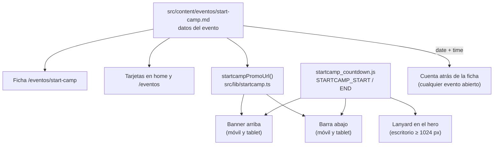

# 06 · Start Camp 2026

Start Camp (7 y 8 de noviembre de 2026, Mad Tech Campus) es el evento más importante del curso, y la web lo promociona en todas partes. Este documento explica cada pieza y **qué hacer cuando acabe**.

## Las piezas

| Pieza | Archivo | Dónde sale | Qué hace |
|---|---|---|---|
| **Datos** | `src/content/eventos/start-camp.md` | — | Fechas, lugar, precio, enlace de Neonpass, premios, mentores, jurado e info práctica |
| **Ficha** | `src/pages/eventos/[slug].astro` | `/eventos/start-camp` | Cabecera con cuenta atrás (calculada con `date` y `time` del `.md`; la tiene cualquier evento abierto), premios, info práctica, mentores y jurado, galería y botón de compra |
| **Tarjetas** | `src/pages/index.astro`, `src/pages/eventos/index.astro` | Home y `/eventos` | "Reservar plaza" va a Neonpass y "Ver evento", a la ficha |
| **Lanyard** | `src/components/lanyard/startcamp-lanyard.tsx` (+ `lanyard_motion.js`) | Hero de la home, solo ≥ 1024 px | Acreditación colgante que se puede arrastrar, con QR de Neonpass y cuenta atrás. Se puede cerrar (durante la sesión) |
| **Banner** | `src/components/StartcampBanner.astro` | Arriba del menú, en todas las páginas, < 1024 px | Cuenta atrás y "Reservar". Se puede cerrar |
| **Barra** | `src/components/StartcampBar.astro` | Abajo y fija, < 1024 px, al bajar 500 px | Cuenta atrás y "Reservar". No sale en `/socios` (taparía el pago) |
| **Reloj** | `src/components/lanyard/startcamp_countdown.js` | — | `STARTCAMP_START` y `STARTCAMP_END`: la hora del evento para el lanyard, el banner y la barra |
| **Dónde salen los avisos** | `src/lib/startcamp.ts` | — | Ni en la propia ficha ni en las páginas que se le pasen en `exclude` |

## Cambiar datos

- **Premios, mentores, jurado, info práctica, precio:** en `start-camp.md`. Los campos están explicados en [04 · Contenido](04-contenido.md#todos-los-campos). La fuente es la página del proyecto **StartCamp** en el Notion de Start, sección *Confirmado hasta la fecha*. Solo se publica lo que esté ahí.
- **Enlace de compra:** campo `external` de `start-camp.md`. El lanyard tiene su propio `EVENT_URL` y su QR (`src/assets/component_assets/startcamp-neonpass-qr.svg`): si cambia el enlace, hay que cambiar los tres.
- **Hora de inicio o fin:** en `startcamp_countdown.js` **y** en `date`, `time` y `endTime` de `start-camp.md`. Las dos tienen que coincidir.

## Por qué se oculta solo

El banner, la barra y el lanyard comprueban en el navegador si `Date.now()` ha pasado `STARTCAMP_END`. Si ya ha pasado, no se muestran, **aunque nadie haya desplegado**. La cuenta atrás de la ficha se esconde sola al llegar a la hora de inicio. La ficha pasa a "Evento celebrado" en el siguiente build (ver [02 · Arquitectura](02-arquitectura.md#cómo-se-genera-una-página)).

## Cuando acabe el Start Camp (checklist)

- [ ] Desplegar (cualquier PR) para que la ficha pase a "Evento celebrado" y la tarjeta, a eventos anteriores.
- [ ] Añadir las fotos de esta edición a `src/assets/fotos/` y a `eventoFotos['start-camp']` en `src/lib/fotos.ts`, y quitar `galleryTitle: 'Así fueron otros Start Camp'`.
- [ ] Escribir la crónica en `start-camp.md`: qué pasó, ganadores, cifras reales (#64).
- [ ] Decidir si se retiran el lanyard, el banner y la barra del código, o si se reutilizan para el siguiente evento. Para retirarlos:
  - Quitar `<StartcampLanyard>` y el script que reserva su columna en `src/pages/index.astro`.
  - Quitar `<StartcampBanner />` y `<StartcampBar />` de `src/layouts/Base.astro`.
  - Borrar `src/components/lanyard/`, `StartcampBanner.astro`, `StartcampBar.astro` y `src/lib/startcamp.ts`.
  - La cuenta atrás de la ficha es genérica (cualquier evento abierto con hora): no hace falta quitarla.
- [ ] Para el Start Camp 2027: renombrar `start-camp.md` a `start-camp-2026.md` (su URL cambiará) y crear el nuevo.
