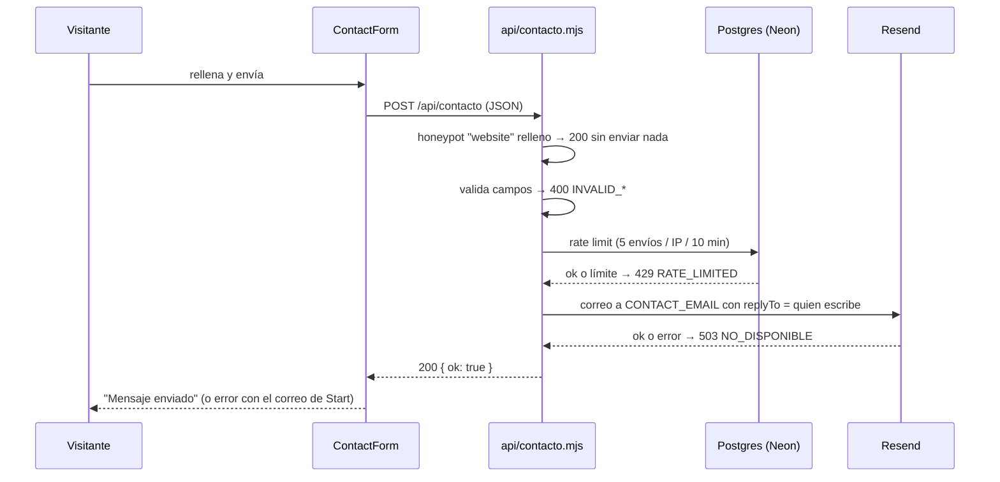

# 07 · Formularios

La web es estática, así que los formularios llaman a funciones de `api/`, que Vercel sirve junto a la web. Hoy hay dos: **contacto/patrocinio** y **socios**.

| Formulario | Dónde | Backend | Documentación |
|---|---|---|---|
| Contacto | `/contacto`, home | `api/contacto.mjs` | Este documento |
| Patrocinio | `/patrocina` | `api/contacto.mjs` (`form: 'patrocinio'`) | Este documento |
| Alta de socios | `/socios` | `api/membership/*`, `api/stripe/webhook.mjs` | [socios.md](socios.md) |
| Teléfono del socio | `/socios/telefono?t=…` | `api/membership/telefono.mjs` | [socios.md](socios.md) |
| Inscripción a eventos | — | **Neonpass** (externo) | Campo `external` del evento, ver [04](04-contenido.md#eventos) |

## Contacto y patrocinio

Componente: `src/components/ContactForm.astro` (`form="contacto" | "patrocinio"`, `dark` para fondos oscuros).

**Petición:** `POST /api/contacto` con JSON `{ form, nombre, email, mensaje, asunto?, empresa?, privacidad, website }`.

| Respuesta | Cuándo |
|---|---|
| `200 { ok: true }` | Enviado (o era un bot que rellenó el honeypot) |
| `400 { error: 'INVALID_FORM' \| 'INVALID_NAME' \| 'INVALID_EMAIL' \| 'INVALID_MESSAGE' \| 'PRIVACY_REQUIRED' }` | Datos que no cumplen. Nombre ≥ 2 caracteres, mensaje ≥ 10 y casilla de privacidad marcada |
| `429 { error: 'RATE_LIMITED' }` | Más de 5 envíos desde la misma IP en 10 minutos, **o la BD no responde** (es público y manda correo: ante la duda, se rechaza) |
| `503 { error: 'NO_DISPONIBLE' }` | Resend no está configurado o ha fallado |

Principios:
- **Nunca se dice "recibido" si no se ha enviado.** Si falla, el formulario lo dice y da el correo de Start para escribir directamente.
- **No se guarda nada**: el mensaje solo existe en el correo que llega al buzón (`CONTACT_EMAIL`, por defecto startuc3m@gmail.com).
- El `replyTo` es quien escribe: se contesta directamente desde el buzón.

## Únete (entrar en el equipo)

Las inscripciones están cerradas (#31) y `/unete` no tiene formulario. Para la próxima convocatoria:
1. Crear un handler en `api/` siguiendo el patrón de `api/contacto.mjs` (honeypot, validación, rate limit, Resend).
2. Crear el formulario en `/unete`, basado en `ContactForm.astro`.
3. Revisar con Legal qué datos se piden y actualizar `/privacidad`.

## Correo de acceso al perfil del Start Camp

El perfil del Start Camp (`/eventos/start-camp/avatar`) no tiene formulario en `api/`: se entra con un enlace de un solo uso que manda Supabase (magic link). La plantilla de ese correo es `docs/correo-enlace-startcamp.html`. Todo el perfil está documentado en [`startcamp-perfil.md`](startcamp-perfil.md).

- **Dónde va:** Supabase → Authentication → Emails → Templates → **Magic Link**. La pega quien administra Supabase; no se despliega con la web.
- **Asunto:** `Tu enlace para entrar en tu perfil del Start Camp`
- **Variables:** `{{ .ConfirmationURL }}` (el enlace, caduca en 1 hora) y `{{ .Data.nombre }}` (`user_metadata.nombre`, lo carga el script de entradas). Se pegan tal cual, sin sustituirlas.
- **Saludo:** si `user_metadata.nombre` no existe, queda en «Hola:».
- **Remitente:** no está en la plantilla; se configura aparte en el SMTP personalizado de Supabase (Resend).

## Newsletter

Se quitó de toda la web (#35). Si vuelve, hace falta decidir el proveedor y el texto legal antes de escribir código.
