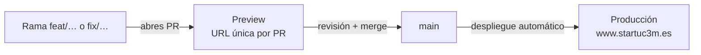

# 08 · Despliegue

La web se despliega sola en **Vercel** (proyecto `start-uc3m`). No hay que ejecutar nada a mano.

## Entornos

| Entorno | Cuándo se crea | URL | Datos |
|---|---|---|---|
| **Local** | `npm run dev` | `localhost:4321` | Lo que tengas en tu rama. Socios solo con `dev:api` y BD de pruebas |
| **Preview** | Cada push a una rama con PR | La pone el bot de Vercel en el PR | Variables de *Preview* (Stripe en modo test) |
| **Producción** | Cada merge a `main` | https://www.startuc3m.es | Variables de *Production* (Stripe real) |

> Las previews tienen **Deployment Protection**: piden iniciar sesión con una cuenta de Vercel del equipo. Para enseñar una preview a alguien de fuera, crea un enlace para compartir desde Vercel.

## Qué hace Vercel en cada despliegue

1. `npm ci` (instala dependencias exactas de `package-lock.json`).
2. `npm run build` (Astro genera `dist/`). **Si falla, no se publica nada** y la versión anterior sigue en pie.
3. Publica `dist/` y las funciones de `api/` (máximo 15 s por llamada, en `vercel.json`).

Tarda entre 1 y 3 minutos. Puedes seguirlo en Vercel → *Deployments*.

## Variables de entorno

Se configuran en Vercel → *Settings → Environment Variables*, por entorno. **Nunca** en el código ni en git.

| Variable | Production | Preview | Para qué |
|---|---|---|---|
| `DATABASE_URL` | Neon (rama principal) | Neon (rama de pruebas) | Socios, rate limit |
| `STRIPE_SECRET_KEY` | `sk_live_…` | `sk_test_…` | Pagos |
| `STRIPE_WEBHOOK_SECRET` | El del endpoint live | El del endpoint test | Verificar el webhook |
| `STRIPE_PRODUCT_STANDARD`, `STRIPE_PRODUCT_PREMIUM` | Opcional | Opcional | Productos de Stripe (si no, se crean al vuelo) |
| `RESEND_API_KEY`, `EMAIL_FROM` | ✅ | ✅ | Correos |
| `CONTACT_EMAIL` | Opcional | Opcional | Buzón del formulario de contacto |
| `NEXT_PUBLIC_SITE_URL` | `https://www.startuc3m.es` | URL de preview | Enlaces en los correos |
| `NOTION_API_KEY`, `NOTION_SOCIOS_DATABASE_ID` | ✅ | Base de pruebas | Ficha del socio en Notion |

Si cambias una variable, **hay que volver a desplegar** para que se aplique (Vercel → *Deployments* → *Redeploy*).

## Dominios

- Canónico: **`www.startuc3m.es`** (`site` en `astro.config.mjs`, `canonical` de cada página y sitemap).
- `startuc3m.es` → `www` con un **308** (configurado en Vercel → *Domains*).
- Cualquier servicio que llame a la web (el webhook de Stripe, por ejemplo) tiene que usar la URL con `www`.

## Analítica

Vercel Web Analytics (PR #75): visitas sin cookies, así que no hace falta banner de consentimiento. Además registra los clics en **"Hazte socio"** y **"Reservar plaza"**, con la zona desde la que se pulsan (menú, pie, banner, barra, lanyard o página).

- Hay que activarlo en Vercel → *Analytics → Enable*.
- Los clics (eventos personalizados) **solo cuentan en los planes Pro y Enterprise** de Vercel. En el plan gratuito solo se ven las visitas.
- Se ve en Vercel → *Analytics* → *Events*.

## Volver atrás (rollback)

Si algo se rompe en producción:

1. **Lo más rápido:** Vercel → *Deployments* → el último despliegue bueno → **Instant Rollback**. Tarda segundos y no toca git.
2. **Después**, arregla el código: `git revert <commit>` en una rama, PR y merge. Si haces solo el rollback, el siguiente merge volverá a publicar el error.

Referencias útiles:
- La etiqueta `web-cra-final` apunta al último commit de la web anterior (la de React/CRA), por si alguna vez hace falta consultarla.
- La web nueva entró en producción con el PR #57 (18/10/2026).

## Checklist después de un despliegue importante

- [ ] Home, `/eventos`, la ficha del próximo evento, `/socios`, `/equipo` y `/podcast` cargan.
- [ ] En un móvil real: menú, avisos de Start Camp y `/socios`.
- [ ] `https://www.startuc3m.es/logo-email.png` sigue existiendo (lo cargan los correos ya enviados).
- [ ] Si se ha tocado socios: Stripe → *Developers → Webhooks* sin entregas fallidas.
