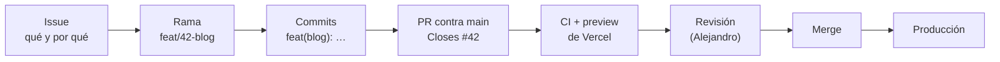

# 10 · Cómo trabajamos

Cómo organizamos el trabajo en IT para que cualquiera pueda seguir lo que hacen los demás.

## El ciclo de un cambio



1. **Todo empieza en un issue.** Si no existe, créalo: qué hay que hacer, por qué y cuándo está hecho.
2. **Una rama por issue**, desde `main` actualizado.
3. **PR pequeño**: mejor tres PRs que se entienden que uno enorme.
4. **Revisión** de Alejandro Ausina (responsable de IT) antes de mergear.
5. **Merge** a `main` → se publica solo (ver [08 · Despliegue](08-despliegue.md)).

## Ramas

| Prefijo | Para | Ejemplo |
|---|---|---|
| `feat/` | Algo nuevo | `feat/62-analitica` |
| `fix/` | Arreglar algo | `fix/44-premios-start-camp` |
| `docs/` | Solo documentación | `docs/documentacion-completa` |
| `chore/` | Mantenimiento (dependencias, limpieza) | `chore/actualizar-astro` |

Formato: `<prefijo>/<número de issue>-<tema-corto>`. `main` es producción: **nunca se hace push directo a `main`**.

## Commits

En español y con [*conventional commits*](https://www.conventionalcommits.org/es/):

```
<tipo>(<ámbito>): <qué cambia, en minúscula y sin punto>

<por qué, si no es obvio>

Refs #44
```

| Tipo | Cuándo |
|---|---|
| `feat` | Funcionalidad o contenido nuevo |
| `fix` | Corrección |
| `docs` | Documentación |
| `style` | Solo formato, sin cambio de comportamiento |
| `refactor` | Reorganizar código sin cambiar lo que hace |
| `test` | Tests |
| `chore` | Dependencias, configuración, limpieza |

Ámbitos habituales: `eventos`, `podcast`, `blog`, `equipo`, `socios`, `contacto`, `home`, `startcamp`, `seo`.

Ejemplos reales: `fix(eventos): premios del Start Camp según Notion (29/10)`, `feat(podcast): los 37 episodios de StartTheWeek con datos reales de YouTube`.

## Pull requests

Un buen PR tiene:

- **Título** con el mismo formato que un commit.
- **Qué cambia y por qué**, en lenguaje que entienda alguien de otro departamento.
- **Cómo se ha probado**: `npm run build`, `npm test`, móvil y escritorio, Lighthouse si aplica.
- **Capturas** si cambia algo visible.
- **Enlace al issue**: `Closes #N` si lo cierra, `Refs #N` si solo avanza.
- **Lo que queda pendiente o necesita a otra persona** (por ejemplo, activar algo en Vercel).

Y antes de pedir revisión: el CI en verde y la preview de Vercel revisada.

## Issues, etiquetas e hitos

**Etiquetas:**

| Etiqueta | Significa |
|---|---|
| `tipo: feature` | Funcionalidad nueva o portada |
| `tipo: tarea` | Trabajo técnico o de limpieza |
| `tipo: contenido` | Textos, datos, imágenes |
| `tipo: validación` | Necesita confirmación de alguien fuera de IT |
| `área: frontend` · `área: socios` · `área: formularios` · `área: infra` | Qué parte toca |
| `prioridad: crítica` | Puede romper pagos o bloquear un lanzamiento |
| `bloqueado: directiva` | Esperando respuesta de la directiva o de un departamento |
| `good first issue` | Bueno para alguien que acaba de entrar |

**Hitos** (de la migración a la web nueva, octubre de 2026): `M0 · Preparación`, `M1 · Base técnica`, `M2 · Socios y legal`, `M3 · Contenido`, `M4 · Formularios`, `M5 · Lanzamiento` y `M6 · Post-lanzamiento`.

Cuando un issue depende de otro departamento, se deja un comentario con **qué se ha preguntado, a quién y cuándo**, para que cualquiera pueda retomarlo.

## Reglas de Start

1. **No se publica nada que no esté confirmado**: cifras, eventos, premios, ponentes, promesas a empresas.
2. **Notion de Start: solo lectura.** Se usa como fuente (equipo, eventos, Start Camp), pero la web nunca escribe en él, salvo la ficha del socio que crea el webhook.
3. **Datos personales:** nunca se publican correos ni teléfonos de miembros. Las fotos del equipo, solo las que cada persona ha subido.
4. **Secretos:** las claves van en las variables de entorno de Vercel o en `.env.local`. Nunca en el código, en un issue ni en un PR.
5. **Pagos:** todo lo que toque `api/` o `db/` se prueba con Stripe en modo test antes de mergear.

## Quién es quién

| Rol | Persona | Para qué |
|---|---|---|
| Responsable de IT | Alejandro Ausina | Revisa y mergea los PRs; acceso a Vercel y Stripe |
| Equipo de IT | Ver `/equipo` (departamento IT) | Desarrollo |
| Comunicación | — | Valida textos y posts del blog |
| Marketing | — | Brand kit y fotos (Drive) |
| Eventos | — | Datos de los eventos (Notion) |
| Partnerships | — | Patrocinadores y media kit |
| Legal | — | Privacidad y consentimientos |

El diseño de partida de esta web es de Ángel Martín ([aaangelmartin/WebStartUC3M](https://github.com/aaangelmartin/WebStartUC3M)), importado en #14 y adaptado después al brand kit de Marketing 26/27.
